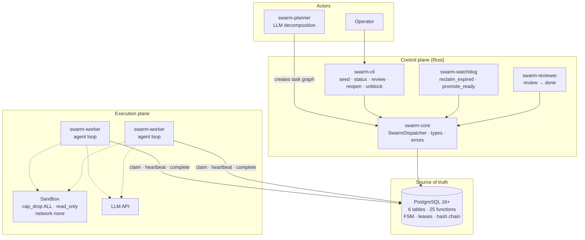

<div align="center">

# Swarm Dispatcher

**Postgres-centric orchestration for AI agent swarms on cheap, heterogeneous hardware.**

[](https://github.com/xodapi/swarm-dispatcher-public/actions/workflows/release-gate.yml)
[](https://github.com/xodapi/swarm-dispatcher-public/actions/workflows/secret-scan.yml)
[](LICENSE)
[](Cargo.toml)
[](schema/schema_v0.sql)

[Русская версия](README.ru.md) · [Architecture](docs/ARCHITECTURE.md) · [Known limitations](docs/KNOWN_LIMITATIONS.md) · [Changelog](CHANGELOG.md)

</div>

---

## Why this exists

Most agent orchestrators optimise for **latency** and assume a homogeneous fleet
with a reliable network. That is the wrong trade-off for a large class of real
work: refactoring a repository, analysing a corpus, generating thousands of
artefacts. Here a task may legitimately run for eight hours, workers differ in
RAM and GPU, and the machine holding a lease may simply die.

Swarm Dispatcher optimises for **completability on unreliable, heterogeneous
hardware**. It is a control plane, not a runtime: it decides *who may do what,
for how long, and at what cost* — and it keeps that decision auditable even when
a worker lies, stalls, or disappears.

**Good fit**

- Batch work measured in hours, not milliseconds
- Mixed fleets — different models, different hardware, different throughput
- Local clusters with no cloud dependency
- Budgets that must be enforced, not merely reported

**Poor fit**

- Interactive assistants where latency is the product
- Real-time systems
- A single worker on a single machine — this is overkill; use something simpler

---

## What it is

A kanban-like task state machine whose **only source of truth is PostgreSQL 16+**.
No Redis, no external durable-execution service, no policy engine.

Six tables (`tasks`, `artifacts`, `task_deps`, `workers`, `events`, `reviews`),
25 SQL functions, and eight task states:

```
pending → ready → leased → review → done
             ↑        │        │
             │        ↓        │
          blocked ← failed     │
             ↑                 │
     budget_exhausted          │
                               │
  review verdicts ─────────────┘
    approved                 → done
    changes_requested        → ready  (rework + 1)
    rejected                 → blocked (block_reason = 'rejected')
    changes_requested when rework is exhausted → blocked (max_rework)
```

State transitions happen **inside SQL functions**, not in application code.
A worker cannot move a task by writing to a table; it can only call
`claim_task`, `save_artifact`, `complete_task`, `submit_review` and friends,
each of which validates identity, lease, and contract.

### The four guarantees

| Guarantee | Mechanism |
|---|---|
| **No zombie workers** | Fencing token `tasks.lease_epoch` — a monotonic counter, not a UUID. Every write re-checks it; a resurrected worker's lease is stale by construction. |
| **No silent history rewrite** | Per-task hash chain (`prev_hash` → `hash`) over `events`, verified by `verify_chain`. Tampering is *detectable*, not prevented — see [limitations](docs/KNOWN_LIMITATIONS.md). |
| **No orphaned descendants** | Recursive cascade: `reopen_task` rolls back the entire subtree, `fail_task` blocks dependants rather than leaving them `ready`. |
| **No unbounded spend** | Cost ledger checked *before* each LLM call, fail-closed. `MAX_TOTAL_COST_USD`, per-run `MAX_LLM_CALLS` / `MAX_DURATION_SEC`, circuit breaker on 401/403. |

---

## Architecture



Six C4 diagrams — context, containers, data, states, flows, deployment — live in
[docs/ARCHITECTURE.md](docs/ARCHITECTURE.md).

**Identity is a database role, not a bearer token.** Each worker connects as its
own Postgres role (`swarm_worker_w1`, `swarm_worker_w2`, …); `claim_task` and
friends call `assert_lease`, which compares `current_user` against the lease
owner. A worker cannot claim another worker's task by passing a different ID —
there is no ID to pass.

---

## Quick start

### Docker Compose

```bash
git clone https://github.com/xodapi/swarm-dispatcher-public.git
cd swarm-dispatcher-public

# .env with the service-role passwords (see .env.example for the full list)
printf 'DB_PASSWORD=%s\n' "$(head -c 24 /dev/urandom | base64 | tr -d '/+=')" > .env

docker compose up -d --build
docker compose run --rm --no-deps cli swarm-cli seed
docker compose run --rm --no-deps cli swarm-cli status
```

Within about a minute you should see tasks sitting in `review` and `ready`, and
a JSON event with `"reclaimed": 1` in the watchdog log — that line is the
fencing mechanism proving itself on a deliberately expired lease.

> **Note on the CLI.** Always invoke it as
> `docker compose run --rm --no-deps cli swarm-cli <command>`.
> Without `--no-deps`, Compose overrides the container entrypoint.

### Demo console

```bash
./scripts/start_demo.sh            # builds, starts, opens the browser
./scripts/start_demo.sh --no-open  # headless
./scripts/start_demo.sh --down     # stop and remove, including the database
```

A kanban board plus swarm view backed entirely by the engine's own database —
no terminal, no `cargo test` on screen. See [demo/README.md](demo/README.md).

### Without Docker

Postgres in user space, no root required — see
[docs/optional/NATIVE_SETUP.md](docs/optional/NATIVE_SETUP.md).

---

## Components

| Crate | Role |
|---|---|
| `swarm-core` | Dispatcher, transaction wrapper, domain types, error codes |
| `swarm-llm` | HTTP LLM client: `openai`, `anthropic`, `openai-compatible`, `mock`; retries, body truncation |
| `swarm-planner` | LLM task decomposition plus a plan validator that rejects malformed graphs |
| `swarm-worker` | Agent loop, shell-tool allowlist, playbooks, cost ledger |
| `swarm-reviewer` | Independent acceptance — reads the artefact, never invents a pass |
| `swarm-watchdog` | `reclaim_expired` + `promote_ready` every 30 s |
| `swarm-cli` | `seed`, `status`, `review`, `reopen`, `unblock` |

SQL is applied in a fixed order; the sequence matters because later patches
redefine function bodies:

```
schema/schema_v0.sql
  → step2/roles.sql
  → step2b/roles_2b.sql
  → step2/roles_patch_planner_status.sql
  → step2/roles_patch_tool_call_audit.sql
```

Then the 14 incremental migrations in `schema/migrations/` (001–014), which are
additive and safe on a live volume.

---

## Verification

This repository is built around the idea that **a check which cannot fail is
worse than no check**. That principle is enforced on the checks themselves.

```bash
# Full STRICT gate — mirrors CI exactly
scripts/acceptance_harness.sh --base main --branch HEAD \
  --full-workspace-test --allowlist-file scripts/acceptance_allowlist.txt
```

The gate runs 44 checks against a disposable PostgreSQL container: FSM
invariants, RBAC, review-gate triads, worker identity, planner validation,
sandbox escape attempts, backup/restore round-trip, doc-link drift, ast-grep
architecture rules, and Rust unit plus integration tests.

| Layer | What it proves |
|---|---|
| **Python arbiters** (158 tests) | SQL-level invariants against a real database: leases, cascades, identity, review gate |
| **Rust tests** (302 test functions) | Library and binary behaviour, sandbox boundaries, retry and budget logic |
| **Mutation testing** | Rust M1–M6 and SQL S1–S14 — a surviving mutant fails the build |
| **Secret scan** | Pre-commit hook plus CI; scans the diff for real `.env` values, self-tested |
| **ast-grep rules** | `no-unwrap-in-production`, `no-hardcoded-secrets`, `required-error-context` |
| **Attestation** | Each run emits `harness-*.attestation.json` with `release_gate: STRICT`, `blocked_count: 0`, and the concrete test names that ran |

Deliberate failure modes: a step that cannot run is `BLOCKED`, never `PASS`.
A negative control that greps for nothing is itself a defect — one such
vacuous check was found and fixed in v0.5.2.

Benchmarks and their caveats — including a claim-latency target that was **not**
met — are reported honestly in [bench/REPORT.md](bench/REPORT.md).

---

## Security model

- **Least privilege by role.** `swarm_worker`, `swarm_reviewer`, `swarm_planner`,
  `swarm_operator`, `swarm_cli`, `swarm_watchdog` are separate Postgres roles.
  The reviewer has no `SELECT` on `tasks`/`artifacts`; it goes through
  `review_candidates` and `submit_review`.
- **Deny-by-default shell tools.** `WORKER_SHELL_TOOLS=0` by default. When
  enabled, `ALLOWED_GIT_SUBCMDS` / `ALLOWED_CARGO_SUBCMDS` whitelist
  subcommands, not just options — `git config core.pager "sh -c ..."` is a real
  RCE vector that an options-only filter misses.
- **Sandbox.** `cap_drop: ALL`, `read_only: true`, `network: none`, pids/memory/
  CPU limits, output cap, per-command timeout. Docker socket access is documented
  as a risk, with a socket-proxy alternative in
  [ops/docker-socket-proxy.md](ops/docker-socket-proxy.md).
- **No secrets in history.** The scanner compares the diff against real values
  read from local `.env*` files; a fresh clone with no `.env` must not block
  commits (a regression here was found and fixed).

Threat model and residual risks: [docs/optional/THREAT_MODEL.md](docs/optional/THREAT_MODEL.md).

---

## Known limitations

Stated plainly, because a reference implementation that hides its edges is not a
reference:

1. **Worker identity is a DB role, not mTLS.** A compromised host with valid
   credentials is indistinguishable from the real worker.
2. **The event log is tamper-*evident*, not tamper-*proof*.** The hash chain
   detects rewriting; a trigger does not yet prevent `UPDATE`/`DELETE`.
3. **No rate limiting, no OPA, no Ed25519 approvals.** All deferred to later
   versions by design.
4. **A single Postgres is a bottleneck.** Vertical scaling only for now.
5. **No OpenTelemetry, no dashboard, no alerts.** Logs and SQL, deliberately.
6. **No git integration** in the worker.
7. **Planner on flash-tier models sometimes emits extra roots** — mitigated by
   `normalize_multi_root`, not eliminated.

The maintained list, with per-item status, is
[docs/KNOWN_LIMITATIONS.md](docs/KNOWN_LIMITATIONS.md).

---

## Documentation

| Document | Contents |
|---|---|
| [docs/ARCHITECTURE.md](docs/ARCHITECTURE.md) | Six C4 diagrams: context, containers, data, states, flows, deployment |
| [docs/PROJECT_STATE.md](docs/PROJECT_STATE.md) | What exists today, component by component |
| [docs/KNOWN_LIMITATIONS.md](docs/KNOWN_LIMITATIONS.md) | Every limitation, with status and rationale |
| [docs/METHODOLOGY.md](docs/METHODOLOGY.md) | How this project is built and reviewed |
| [docs/optional/ROADMAP.md](docs/optional/ROADMAP.md) | Version plan |
| [docs/optional/ERRORS.md](docs/optional/ERRORS.md) | Error code reference |
| [docs/optional/ARCHITECTURE_DECISIONS.md](docs/optional/ARCHITECTURE_DECISIONS.md) | Why Postgres, why no Redis, why no OPA |
| [docs/optional/NATIVE_SETUP.md](docs/optional/NATIVE_SETUP.md) | Postgres in user space, no root |
| [docs/ci/CI_COST.md](docs/ci/CI_COST.md) | What CI costs and how to reduce it |
| [MANIFEST.md](MANIFEST.md) | Map of every path in the repository |
| [docs/AGENTS.md](docs/AGENTS.md) | Brief for AI agents working in this repo |

---

## Contributing

Read [CONTRIBUTING.md](CONTRIBUTING.md). In short: one logical change per PR,
the STRICT gate must be green, no direct pushes to `main`, and every claim in a
commit message must be reproducible from the diff.

Found a security issue? [SECURITY.md](SECURITY.md) explains the private channel.

---

## License

Own code — MIT, see [LICENSE](LICENSE).

Playbooks and engineering principles in `crates/swarm-worker/src/playbooks.rs`
are derived from **pstack** (Copyright © 2026 Lauren Tan, MIT). Full attribution
in [THIRD_PARTY_NOTICES.md](THIRD_PARTY_NOTICES.md); license texts in
`LICENSES/`.
