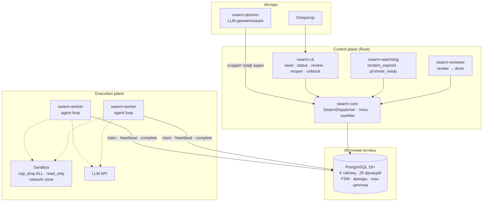

<div align="center">

# Swarm Dispatcher

**Оркестрация роя ИИ-агентов на Postgres — для дешёвого гетерогенного железа.**

[](https://github.com/xodapi/swarm-dispatcher-public/actions/workflows/release-gate.yml)
[](https://github.com/xodapi/swarm-dispatcher-public/actions/workflows/secret-scan.yml)
[](LICENSE)
[](Cargo.toml)
[](schema/schema_v0.sql)

[English version](README.md) · [Архитектура](docs/ARCHITECTURE.md) · [Известные ограничения](docs/KNOWN_LIMITATIONS.md) · [Changelog](CHANGELOG.md)

</div>

---

## Зачем это

Большинство оркестраторов агентов оптимизируют **задержку** и исходят из того,
что парк машин однороден, а сеть надёжна. Для большого класса реальной работы
это неверный компромисс: рефакторинг репозитория, анализ корпуса, генерация
тысяч артефактов. Здесь задача может законно идти восемь часов, воркеры
отличаются по RAM и GPU, а машина, держащая аренду, может просто умереть.

Swarm Dispatcher оптимизирует **доводимость до результата на ненадёжном
гетерогенном железе**. Это control plane, а не runtime: он решает, *кому что
можно делать, как долго и за какие деньги*, — и сохраняет это решение
проверяемым даже когда воркер врёт, зависает или исчезает.

**Подходит**

- Batch-работа, измеряемая часами, а не миллисекундами
- Смешанный парк: разные модели, разное железо, разная пропускная способность
- Локальные кластеры без облачной зависимости
- Бюджеты, которые нужно *удерживать*, а не только показывать

**Не подходит**

- Интерактивные ассистенты, где задержка и есть продукт
- Real-time системы
- Один воркер на одной машине — это оверкилл, возьмите что-нибудь проще

---

## Что это такое

Канбан-подобная машина состояний задач, у которой **единственный источник
истины — PostgreSQL 16+**. Без Redis, без внешнего durable execution, без
policy engine.

Шесть таблиц (`tasks`, `artifacts`, `task_deps`, `workers`, `events`, `reviews`),
25 SQL-функций и восемь состояний задачи:

```
pending → ready → leased → review → done
             ↑        │        │
             │        ↓        │
          blocked ← failed     │
             ↑                 │
     budget_exhausted          │
                               │
  вердикты ревью ──────────────┘
    approved                 → done
    changes_requested        → ready  (rework + 1)
    rejected                 → blocked (block_reason = 'rejected')
    changes_requested при исчерпанном rework → blocked (max_rework)
```

Переходы состояний происходят **внутри SQL-функций**, а не в коде приложения.
Воркер не может сдвинуть задачу записью в таблицу — он может только вызвать
`claim_task`, `save_artifact`, `complete_task`, `submit_review` и соседние
функции, каждая из которых проверяет идентичность, аренду и контракт.

### Четыре гарантии

| Гарантия | Механизм |
|---|---|
| **Нет зомби-воркеров** | Fencing token `tasks.lease_epoch` — монотонный счётчик, не UUID. Каждая запись перепроверяет его; аренда воскресшего воркера устарела по построению. |
| **Нет тихой перезаписи истории** | Хэш-цепочка по задаче (`prev_hash` → `hash`) над `events`, проверяется `verify_chain`. Подделка **обнаружима**, но не предотвращается — см. [ограничения](docs/KNOWN_LIMITATIONS.md). |
| **Нет брошенных потомков** | Рекурсивный каскад: `reopen_task` откатывает всё поддерево, `fail_task` блокирует зависимые, а не оставляет их в `ready`. |
| **Нет неограниченных расходов** | Cost ledger проверяется **перед** каждым вызовом LLM, fail-closed. `MAX_TOTAL_COST_USD`, пределы прохода `MAX_LLM_CALLS` / `MAX_DURATION_SEC`, circuit breaker на 401/403. |

---

## Архитектура



Шесть диаграмм C4 — контекст, контейнеры, данные, состояния, потоки,
развёртывание — в [docs/ARCHITECTURE.md](docs/ARCHITECTURE.md).

**Идентичность — это роль БД, а не bearer-токен.** Каждый воркер подключается
под своей ролью Postgres (`swarm_worker_w1`, `swarm_worker_w2`, …);
`claim_task` и родственные функции вызывают `assert_lease`, которая сравнивает
`current_user` с владельцем аренды. Воркер не может взять чужую задачу,
передав другой ID — передавать нечего.

---

## Быстрый старт

### Docker Compose

```bash
git clone https://github.com/xodapi/swarm-dispatcher-public.git
cd swarm-dispatcher-public

# .env с паролями сервисных ролей (полный список — в .env.example)
printf 'DB_PASSWORD=%s\n' "$(head -c 24 /dev/urandom | base64 | tr -d '/+=')" > .env

docker compose up -d --build
docker compose run --rm --no-deps cli swarm-cli seed
docker compose run --rm --no-deps cli swarm-cli status
```

Примерно через минуту вы должны увидеть задачи в `review` и `ready`, а в логе
сторожа — JSON-событие с `"reclaimed": 1`: эта строка и есть fencing-механизм,
который доказывает себя на намеренно просроченной аренде.

> **Про CLI.** Всегда вызывайте его как
> `docker compose run --rm --no-deps cli swarm-cli <команда>`.
> Без `--no-deps` Compose подменяет entrypoint контейнера.

### Демо-консоль

```bash
./scripts/start_demo.sh            # собрать, поднять, открыть браузер
./scripts/start_demo.sh --no-open  # без браузера
./scripts/start_demo.sh --down     # остановить и удалить вместе с БД
```

Канбан-доска и вид роя, целиком питающиеся из базы самого движка — без
терминала и `cargo test` на экране. См. [demo/README.md](demo/README.md).

### Без Docker

Postgres в user space, без root — см.
[docs/optional/NATIVE_SETUP.md](docs/optional/NATIVE_SETUP.md).

---

## Компоненты

| Крейт | Роль |
|---|---|
| `swarm-core` | Диспетчер, обёртка транзакций, доменные типы, коды ошибок |
| `swarm-llm` | HTTP-клиент LLM: `openai`, `anthropic`, `openai-compatible`, `mock`; ретраи, обрезка тел ответов |
| `swarm-planner` | LLM-декомпозиция плюс валидатор плана, отвергающий некорректные графы |
| `swarm-worker` | Agent loop, allowlist shell-инструментов, плейбуки, cost ledger |
| `swarm-reviewer` | Независимая приёмка: читает артефакт и никогда не выдумывает «прошло» |
| `swarm-watchdog` | `reclaim_expired` + `promote_ready` каждые 30 секунд |
| `swarm-cli` | `seed`, `status`, `review`, `reopen`, `unblock` |

SQL применяется в фиксированном порядке; последовательность важна, потому что
поздние патчи переопределяют тела функций:

```
schema/schema_v0.sql
  → step2/roles.sql
  → step2b/roles_2b.sql
  → step2/roles_patch_planner_status.sql
  → step2/roles_patch_tool_call_audit.sql
```

Затем 14 инкрементальных миграций в `schema/migrations/` (001–014) —
аддитивные и безопасные на живом томе.

---

## Верификация

Репозиторий построен вокруг идеи, что **проверка, которая не может упасть,
хуже отсутствия проверки**. Этот принцип применяется и к самим проверкам.

```bash
# Полный STRICT-гейт — точное зеркало CI
scripts/acceptance_harness.sh --base main --branch HEAD \
  --full-workspace-test --allowlist-file scripts/acceptance_allowlist.txt
```

Гейт прогоняет 44 проверки на одноразовом контейнере PostgreSQL: инварианты FSM,
RBAC, триады review-gate, идентичность воркеров, валидацию планировщика,
попытки побега из sandbox, round-trip backup/restore, дрейф ссылок в
документации, архитектурные правила ast-grep, а также Rust unit- и
интеграционные тесты.

| Слой | Что доказывает |
|---|---|
| **Python-арбитры** (158 тестов) | Инварианты на уровне SQL против реальной БД: аренды, каскады, идентичность, review-gate |
| **Rust-тесты** (302 тест-функции) | Поведение библиотеки и бинарников, границы sandbox, логика ретраев и бюджета |
| **Мутационное тестирование** | Rust M1–M6 и SQL S1–S14 — выживший мутант валит сборку |
| **Секрет-скан** | Pre-commit хук плюс CI; сканирует дифф на реальные значения из `.env`, самопроверяется |
| **Правила ast-grep** | `no-unwrap-in-production`, `no-hardcoded-secrets`, `required-error-context` |
| **Аттестация** | Каждый прогон пишет `harness-*.attestation.json` с `release_gate: STRICT`, `blocked_count: 0` и конкретными именами выполненных тестов |

Намеренные режимы отказа: шаг, который не может выполниться, — это `BLOCKED`,
никогда не `PASS`. Негативный контроль, который ничего не находит, сам является
дефектом — одна такая вакуумная проверка была найдена и исправлена в v0.5.2.

Бенчмарки и их оговорки — включая цель по задержке claim, которая **не была**
достигнута — честно изложены в [bench/REPORT.md](bench/REPORT.md).

---

## Модель безопасности

- **Least privilege по ролям.** `swarm_worker`, `swarm_reviewer`,
  `swarm_planner`, `swarm_operator`, `swarm_cli`, `swarm_watchdog` — отдельные
  роли Postgres. У ревьюера нет `SELECT` на `tasks`/`artifacts`; он ходит через
  `review_candidates` и `submit_review`.
- **Deny-by-default для shell-инструментов.** `WORKER_SHELL_TOOLS=0` по
  умолчанию. При включении `ALLOWED_GIT_SUBCMDS` / `ALLOWED_CARGO_SUBCMDS`
  задают белый список подкоманд, а не только опций: `git config core.pager
  "sh -c ..."` — реальный вектор RCE, который фильтр «только по опциям»
  пропускает.
- **Sandbox.** `cap_drop: ALL`, `read_only: true`, `network: none`, лимиты
  pids/памяти/CPU, ограничение вывода, таймаут на команду. Доступ к
  Docker-сокету задокументирован как риск, альтернатива через socket-proxy — в
  [ops/docker-socket-proxy.md](ops/docker-socket-proxy.md).
- **Секретов в истории нет.** Сканер сверяет дифф с реальными значениями из
  локальных `.env*`; свежий клон без `.env` не должен блокировать коммиты
  (регрессия здесь была найдена и исправлена).

Модель угроз и остаточные риски:
[docs/optional/THREAT_MODEL.md](docs/optional/THREAT_MODEL.md).

---

## Известные ограничения

Изложены прямо, потому что reference implementation, скрывающая свои края, —
не reference:

1. **Идентичность воркера — роль БД, а не mTLS.** Скомпрометированный хост с
   валидными кредами неотличим от настоящего воркера.
2. **Журнал событий tamper-*evident*, но не tamper-*proof*.** Хэш-цепочка
   обнаруживает перезапись; триггер, запрещающий `UPDATE`/`DELETE`, пока не
   поставлен.
3. **Нет rate limiting, нет OPA, нет Ed25519-подтверждений.** Всё отложено до
   следующих версий осознанно.
4. **Один Postgres — узкое место.** Пока только вертикальное масштабирование.
5. **Нет OpenTelemetry, дашборда и алертов.** Логи и SQL — намеренно.
6. **Нет git-интеграции** в воркере.
7. **Планировщик на flash-моделях иногда выдаёт лишние корни** —
   смягчается `normalize_multi_root`, но не устранено.

Поддерживаемый список со статусом по каждому пункту —
[docs/KNOWN_LIMITATIONS.md](docs/KNOWN_LIMITATIONS.md).

---

## Документация

| Документ | Содержание |
|---|---|
| [docs/ARCHITECTURE.md](docs/ARCHITECTURE.md) | Шесть диаграмм C4: контекст, контейнеры, данные, состояния, потоки, развёртывание |
| [docs/PROJECT_STATE.md](docs/PROJECT_STATE.md) | Что существует сегодня, покомпонентно |
| [docs/KNOWN_LIMITATIONS.md](docs/KNOWN_LIMITATIONS.md) | Каждое ограничение со статусом и обоснованием |
| [docs/METHODOLOGY.md](docs/METHODOLOGY.md) | Как этот проект строится и ревьюится |
| [docs/optional/ROADMAP.md](docs/optional/ROADMAP.md) | План версий |
| [docs/optional/ERRORS.md](docs/optional/ERRORS.md) | Справочник кодов ошибок |
| [docs/optional/ARCHITECTURE_DECISIONS.md](docs/optional/ARCHITECTURE_DECISIONS.md) | Почему Postgres, почему без Redis, почему без OPA |
| [docs/optional/NATIVE_SETUP.md](docs/optional/NATIVE_SETUP.md) | Postgres в user space, без root |
| [docs/ci/CI_COST.md](docs/ci/CI_COST.md) | Сколько стоит CI и как его удешевить |
| [MANIFEST.md](MANIFEST.md) | Карта каждого пути в репозитории |
| [docs/AGENTS.md](docs/AGENTS.md) | Бриф для ИИ-агентов, работающих в этом репозитории |

---

## Участие

Прочитайте [CONTRIBUTING.md](CONTRIBUTING.md). Коротко: одно логическое
изменение на PR, STRICT-гейт должен быть зелёным, прямых пушей в `main` нет, и
каждое утверждение в сообщении коммита должно воспроизводиться из диффа.

Нашли проблему безопасности? [SECURITY.md](SECURITY.md) объясняет приватный
канал.

---

## Лицензия

Собственный код — MIT, см. [LICENSE](LICENSE).

Плейбуки и инженерные принципы в `crates/swarm-worker/src/playbooks.rs`
производны от **pstack** (Copyright © 2026 Lauren Tan, MIT). Полная атрибуция —
[THIRD_PARTY_NOTICES.md](THIRD_PARTY_NOTICES.md), тексты лицензий — в
`LICENSES/`.
