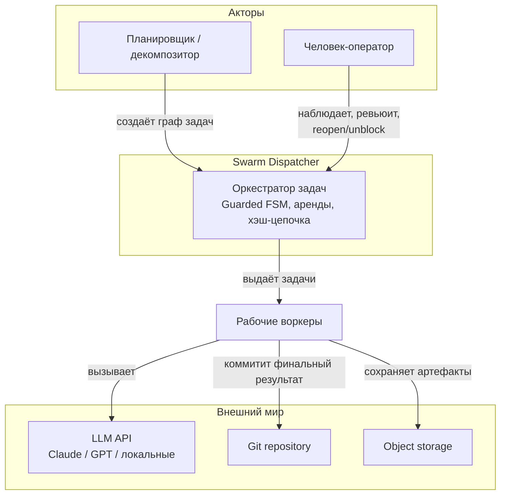
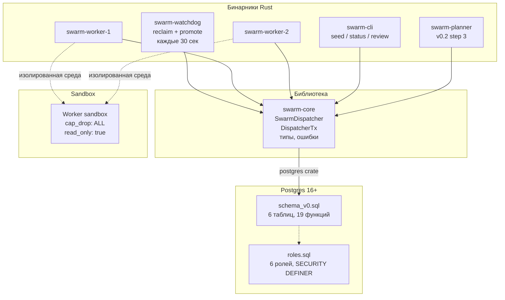
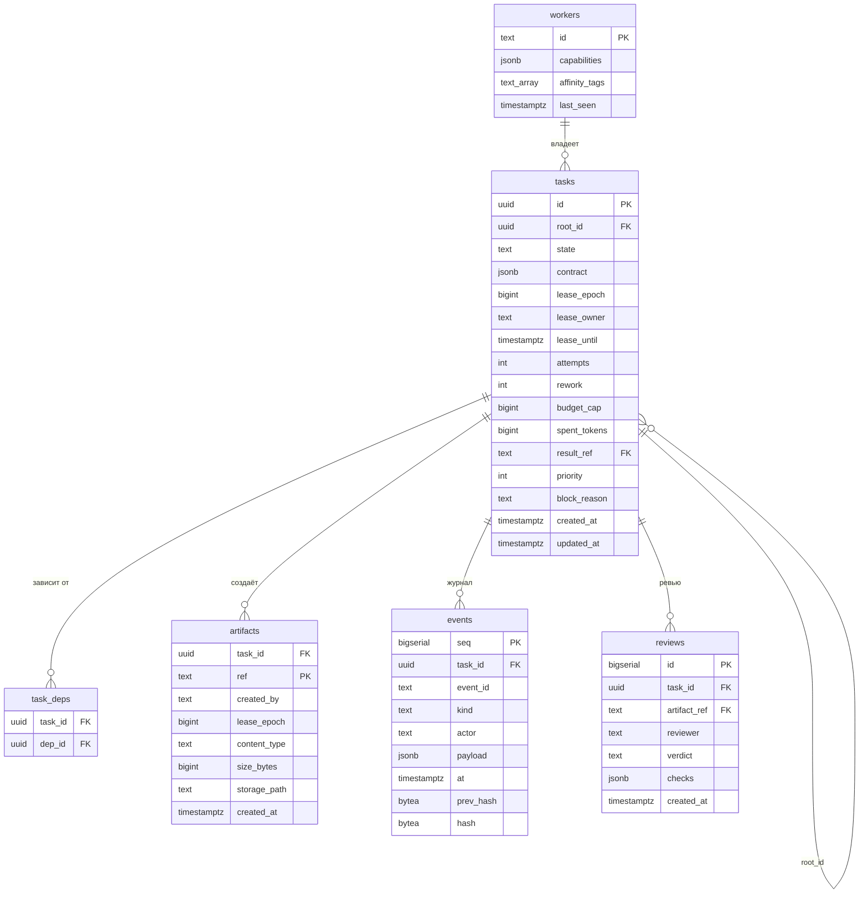
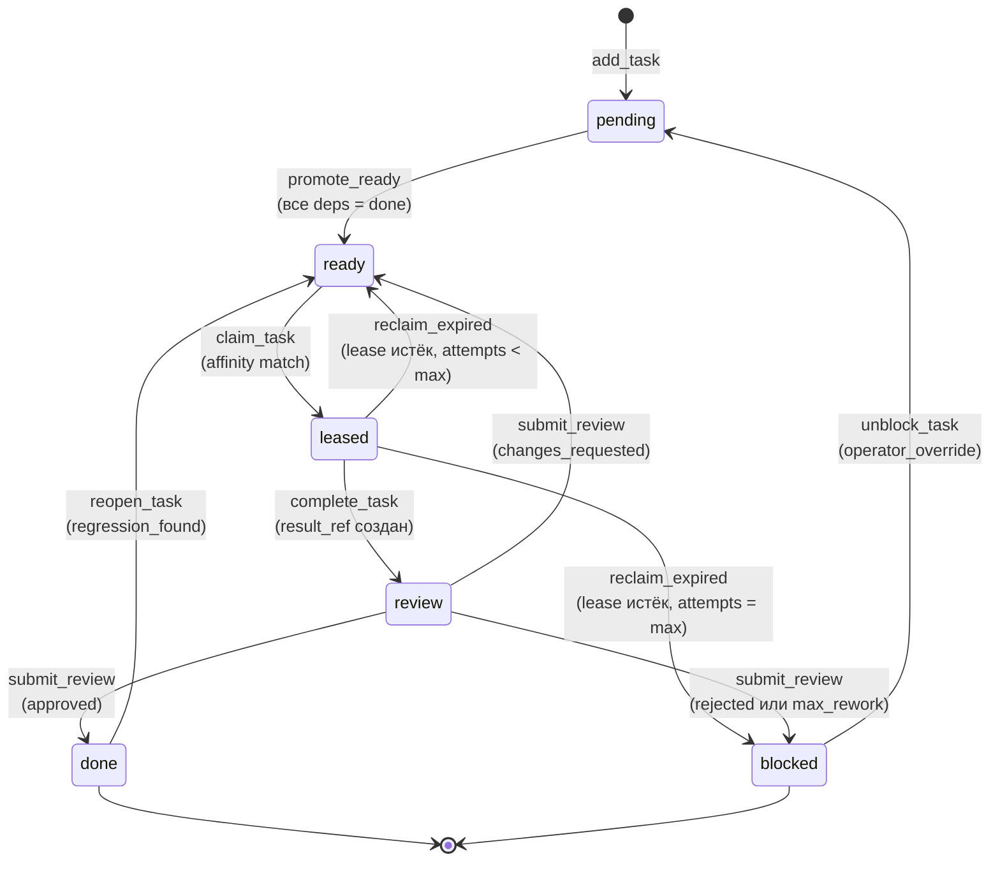
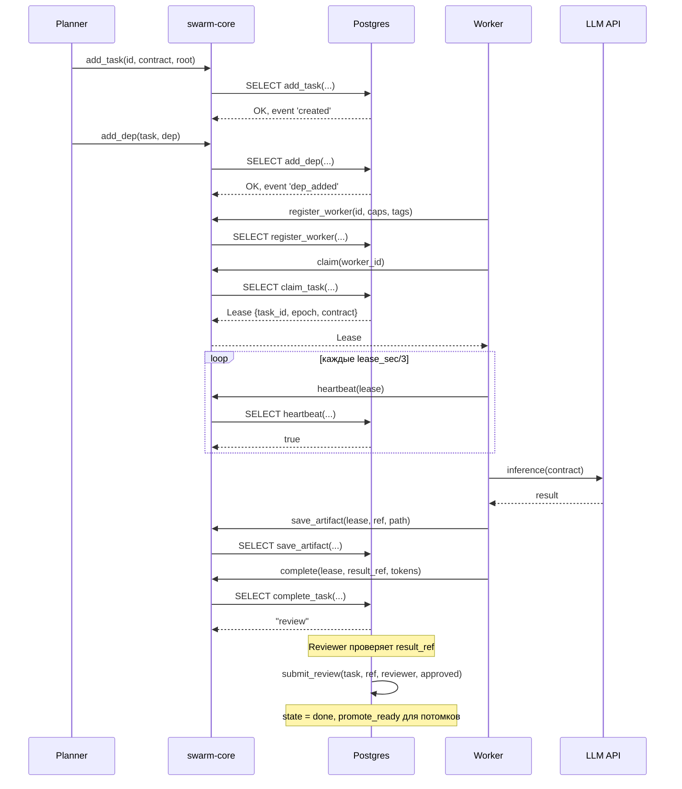
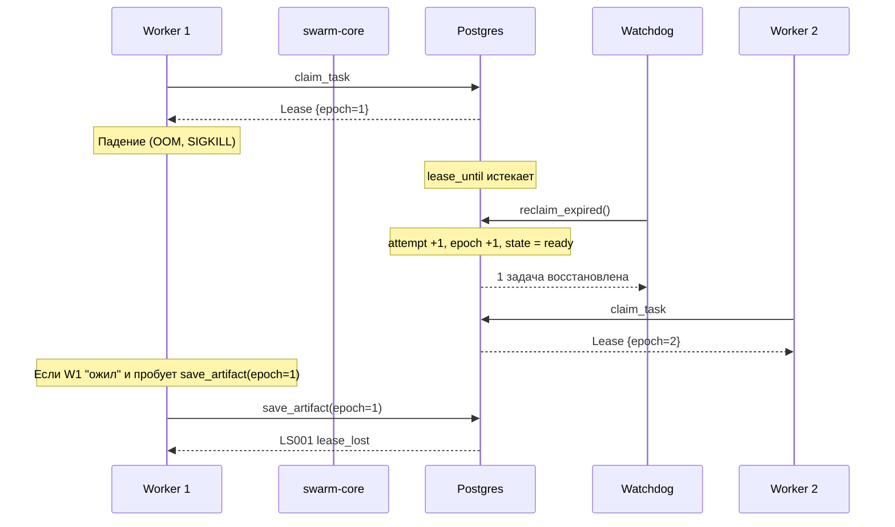
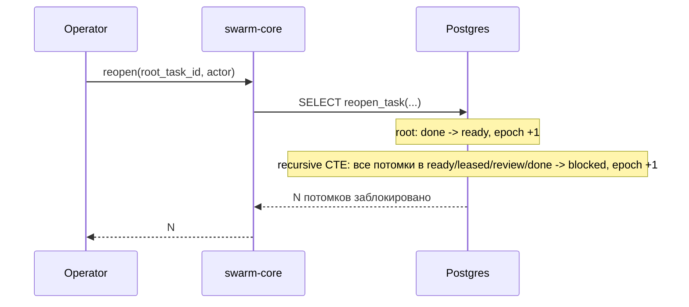
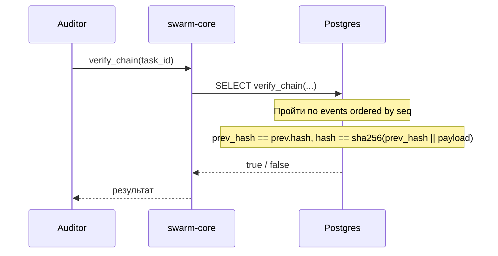
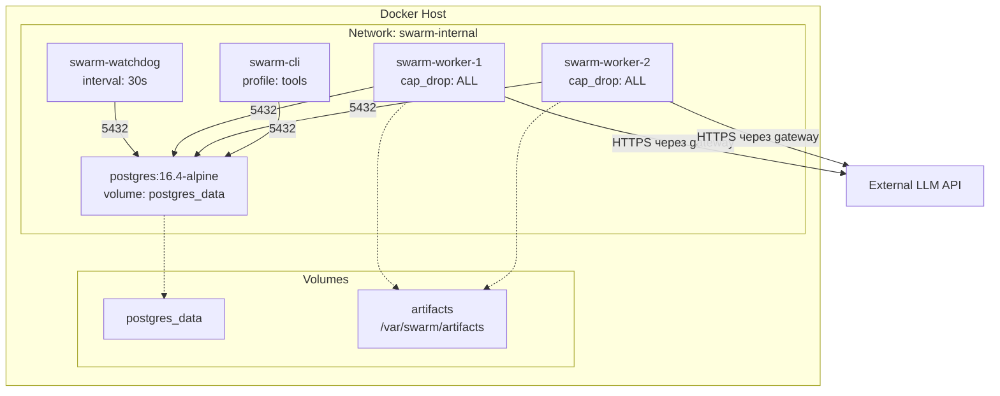

# Архитектура системы

Документ описывает архитектуру reference implementation. Содержит шесть
диаграмм: контекст, контейнеры, данные, состояния, потоки, развёртывание.

Стек: **Postgres 16+** (единственный источник истины) + **Rust 1.85+**
(диспетчер, сторож, воркеры, CLI). Без Redis, без внешних очередей,
без OPA в v0.x.

---

## 1. Контекст системы (C4 Context)

Ключевое: Swarm Dispatcher — Control Plane, который координирует
задачи, но не выполняет их. Воркеры берут задачи по pull-модели и
работают вне транзакций.

---

2. Контейнеры (C4 Container)

Ключевое: все бинарники используют одну библиотеку swarm-core.
Никакого IPC между бинарниками — только через Postgres.

---

3. Модель данных (ER)

Ключевые инварианты схемы:

1. tasks.lease_epoch — монотонный fencing token.
2. tasks.state — CHECK (state IN (...)).
3. events (task_id, event_id) UNIQUE — дедупликация через БД.
4. events.prev_hash / hash — tamper-evidence.
5. artifacts PRIMARY KEY (task_id, ref) — привязка к задаче и хэшу.
6. task_deps PRIMARY KEY (task_id, dep_id) — без дублей рёбер.

---

4. Жизненный цикл задачи (Guarded FSM)

Guards:

· pending → ready: все deps в состоянии done.
· ready → leased: spent_tokens < budget_cap, attempts < budget.attempts,
  capabilities воркера совпадают с needs задачи.
· leased → review: assert_lease (epoch и owner совпадают),
  result_ref существует в artifacts.
· review → done: ревьюер ≠ автор артефакта, все checks прошли,
  verdict = approved.
· leased → ready (reclaim): attempts + 1 < max_attempts.
· done → ready (reopen): роль оператора — ak-maintainer или
  Human_Operator.

Каскадный откат при reopen_task: все потомки в
ready/leased/review/done переходят в blocked с lease_epoch + 1,
что немедленно отсекает зомби-воркеров.

---

5. Потоки данных (Sequence)

5.1. Успешное выполнение

5.2. Падение воркера

5.3. Каскадный откат

5.4. Верификация хэш-цепочки

---

6. Развёртывание (Deployment)

Принципы:

· Postgres — единственный stateful компонент. Backup через WAL.
· Все Rust-бинарники — stateless, N копий.
· Воркеры — изолированные контейнеры с cap_drop: ALL,
  read_only: true, no-new-privileges.
· Egress — только через gateway (для LLM API).
· Volumes — postgres_data (БД) и artifacts (v0 — локальные, v1 — S3).

---
7. Решения, зафиксированные в архитектуре

№ Решение Обоснование
1 Postgres — единственный источник истины Атомарность, дедупликация через UNIQUE
2 Без Redis Устраняет рассинхронизацию и «сгоревший ключ»
3 Fencing token (lease_epoch) Защита от зомби без хранения истории
4 Хэш-цепочка событий Tamper-evidence (не non-repudiation — v2.0)
5 Pull-модель с capabilities Воркер сам решает, брать ли задачу
6 Rust для инфраструктуры Типизация, один бинарник, безопасность
7 Короткие транзакции Долгая операция (inference) вне транзакции
8 Recursive cascade Единый запрос по всему поддереву
9 Без OPA/approvals в v0 Ядро работает без compliance-обвязки
10 Без :latest в Docker Воспроизводимость

---

8. Что не входит в v0.x

· OPA / Policy Engine — v2.0.
· Trust Registry + Approvals (Ed25519) — v2.0.
· CryptoVerifier — v2.0.
· Мультитенантность — v2.0.
· OTel — v1.0.
· Rate limiting — v1.0 (на реверс-прокси).
· S3 для артефактов — v1.0 (в v0.x локальная ФС).

